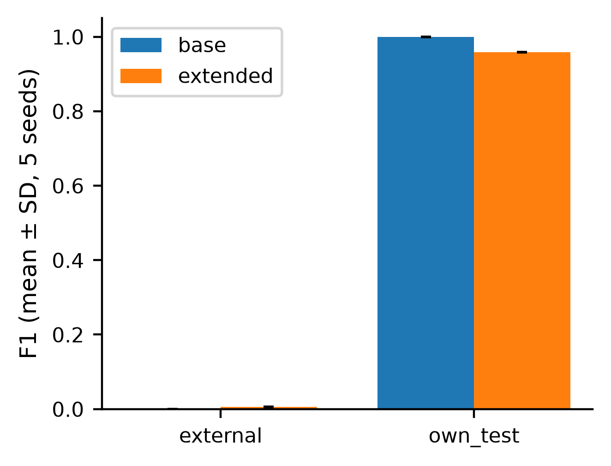

<div align="center">

#  Detecting AI-Written Outreach Messages
### Robustness of text detectors across generators, perturbations and domains


**Members:** NAME1 (roll no.) · NAME2 (roll no.)
**Paper:** TITLE
**Base paper:** CITATION (Q1/Q2 journal, quartile proof in `paper/`)

</div>

---

##  At a glance

| | |
|---|---|
| **Question** | Do AI-text detectors keep working on workplace-style messages when the generator, the formatting or the domain changes? |
| **Own corpus** | 296 human emails (AESLC / Enron subset) + 296 AI emails written for the *same subjects* by two LLMs (`gpt-oss-120b`, `qwen3-27b`) |
| **Second dataset** | HC3 (human vs ChatGPT answers), 300 + 300 texts |
| **Models** | Base: TF-IDF + logistic regression · Extended: + stylometric + emotion-lexicon features |
| **Statistics** | Bootstrap CIs (5,000), McNemar's test, 5 grouped random splits (topic never in both train and test) |

>  **Space for a project overview figure** (e.g. the research-design flowchart from `diagram_sources/`)
>
> ``

---

##  Quick start

```bash
# 1. environment
python -m venv .venv
source .venv/bin/activate          # Windows PowerShell: .venv\Scripts\activate
pip install -r requirements.txt

# 2. data -> data/raw/own_corpus.csv and data/raw/external_corpus.csv
#    (columns: text_id,text,label,generator,domain; see data/codebook_TEMPLATE.csv)

# 3. analysis (run from the project folder, in this order)
python src/01_clean_data.py
python src/02_base_model.py
python src/03_extended_model.py
python src/04_robustness.py
python src/08_top_features.py
python src/09_repeated_splits.py
python src/05_plots.py
```

>  Smoke test without real data: `python src/make_demo_data.py` writes **synthetic** toy data. Never report demo output.
> The notebook `notebooks/i22-xxxx_SECTION.ipynb` runs steps 01-05; run 08 and 09 separately.

<details>
<summary><b> Rebuilding the datasets from scratch</b></summary>

```bash
# human emails (Yale-LILY/aeslc on Hugging Face) -> data/raw/human_sampled.csv
python src/06_build_corpus.py prepare --n 300

# AI emails for the same subjects (API key in env var LLM_API_KEY, never in code)
python src/06_build_corpus.py generate --provider groq --model MODEL --name NAME --start 0 --end 150

# merge into data/raw/own_corpus.csv
python src/06_build_corpus.py assemble

# external corpus (HC3) and emotion lexicon (NRC EmoLex via the nrclex package)
python src/07_build_external.py --per-class 150
python src/10_make_emotion_lexicon.py
```

Human text was scrubbed of e-mail addresses, phone numbers, URLs and a few personal details; names were not removed automatically.
</details>

---

##  Project structure

```
mg3010-ai-text-detection/
├── config.py                  seed, paths, figure style
├── requirements.txt
├── data/
│   ├── raw/                   own_corpus.csv, external_corpus.csv, emotion_lexicon.csv
│   ├── clean/                 cleaned + split data
│   └── codebook_TEMPLATE.csv
├── src/
│   ├── 01_clean_data.py       cleaning + train/val/test split
│   ├── 02_base_model.py       base model
│   ├── 03_extended_model.py   extended model, bootstrap CIs, McNemar
│   ├── 04_robustness.py       perturbations, unseen generators
│   ├── 05_plots.py            figures (400 dpi)
│   ├── 06-07, 10_*.py         dataset and lexicon builders
│   ├── 08_top_features.py     explainability / artefact check
│   └── 09_repeated_splits.py  grouped splits, ablation, cross-corpus transfer
├── notebooks/                 i22-xxxx_SECTION.ipynb
├── tables/                    CSV results
├── figures/                   PNG + PDF
├── diagram_sources/           editable .drawio files
└── paper/                     main.tex, references.bib
```

---

##  Results

> Filled from the final run on real data. Update this table if you rerun anything.

**F1 over 5 grouped random splits (mean ± SD)**

| Model | Own emails | HC3 |
|---|---|---|
| Base (TF-IDF) | 0.989 ± 0.006 | 0.945 ± 0.015 |
| + stylometric | 0.927 ± 0.019 | 0.941 ± 0.008 |
| + stylometric + emotion | 0.932 ± 0.023 | 0.926 ± 0.021 |

**Cross-corpus transfer (ROC-AUC):** own → HC3 and HC3 → own are at or below chance for all models (see `tables/transfer.csv`).

###  Figures

| ROC curves | F1 across splits |
|---|---|
|  |  |

| Robustness checks | Space for your own figure |
|---|---|
|  | *add a plot here* |

---

##  Honest limitations

- Perfect scores on the own corpus are partly **corpus artefacts** (`08_top_features.py`: *hi team*, *friday* for AI; *enron*, *2001* for human).
- The two generators are different families, but each contributes only ~150 emails.
- Grouped splits overlap, so the SDs understate the true uncertainty.
- Detectors do not transfer across domains (email ↔ HC3 Q&A).
- Emotion features come from the NRC EmoLex word list and add no detectable value here.

---

##  Data and licences

- **AESLC** (Annotated Enron Subject Line Corpus), Yale-LILY on Hugging Face.
- **HC3**: Guo et al. (2023), CC-BY-SA-4.0 per its Hugging Face page.
- **NRC EmoLex**: Mohammad & Turney (2013); free for research use. Do **not** redistribute `emotion_lexicon.csv`.
- AI text generated by us; no human participants, so no consent form was required.

---

##  Contributions 

- Aleesha 
- Munaza

*AI tools were used only for grammar, LaTeX debugging and code debugging.*
