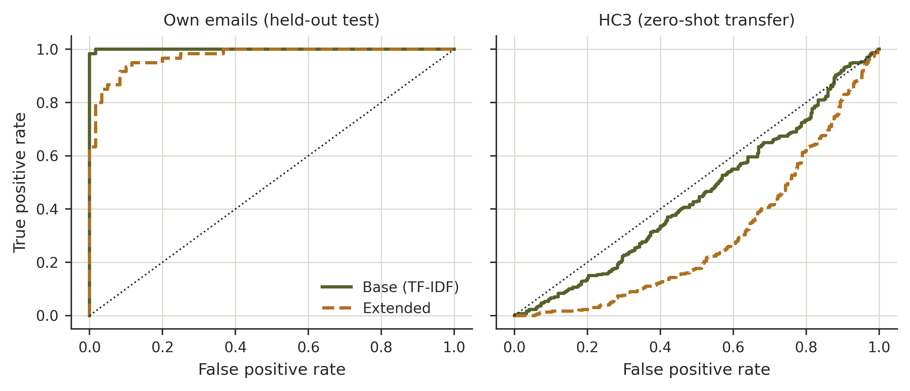
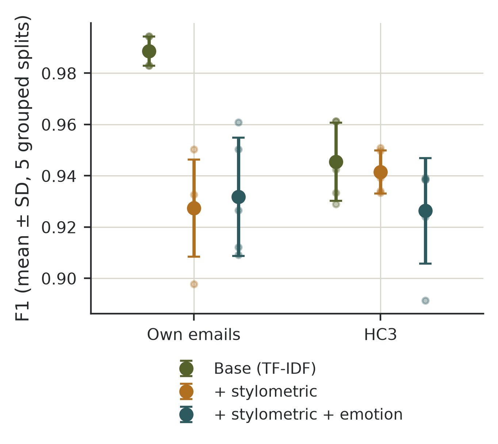
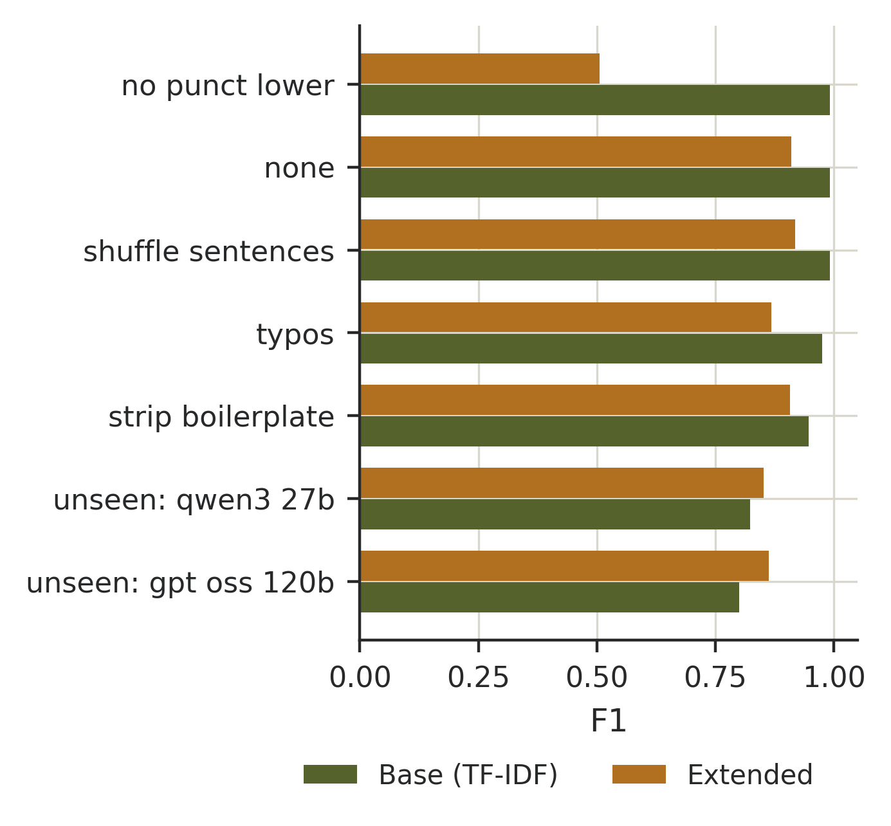
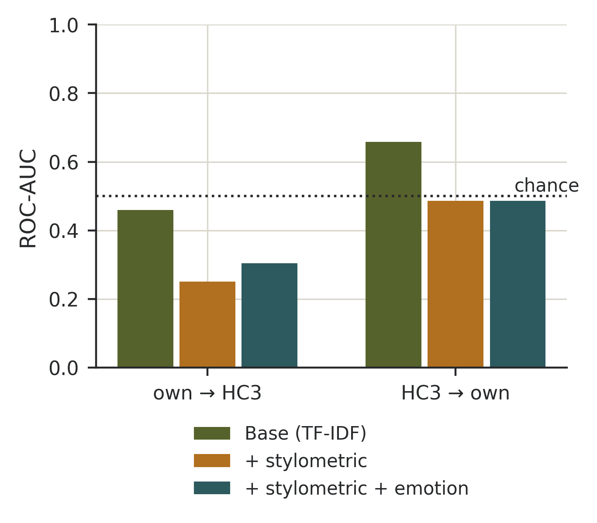
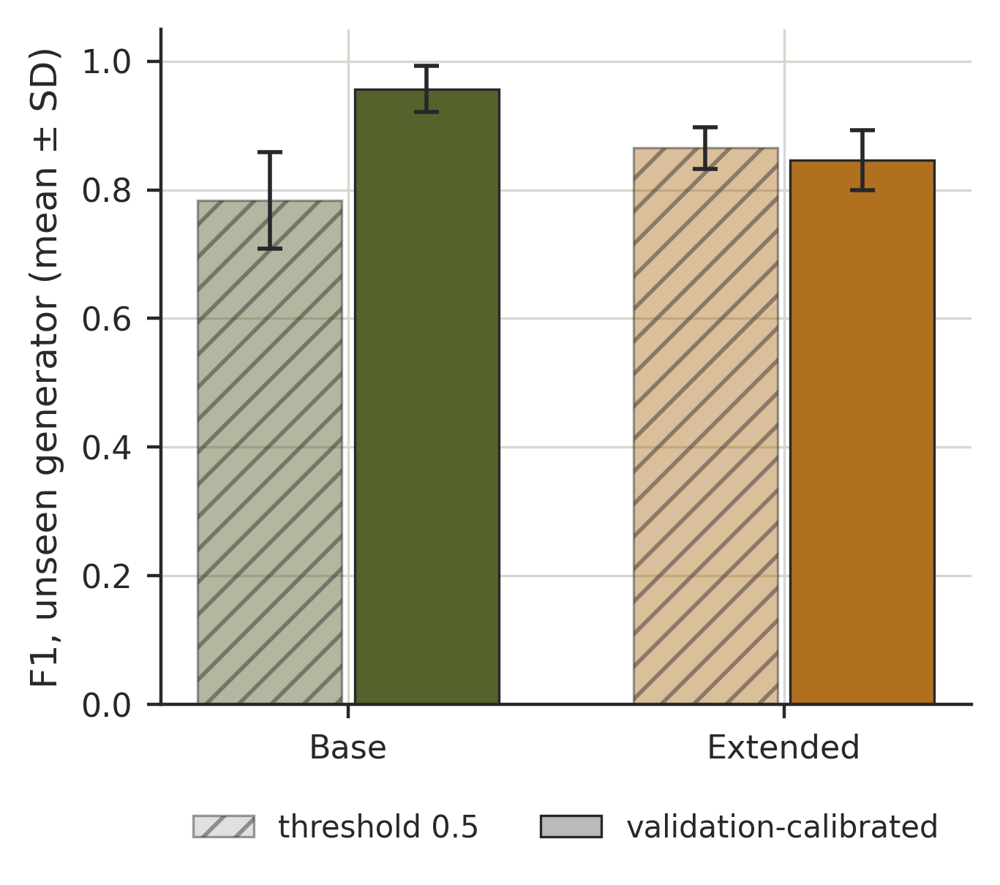
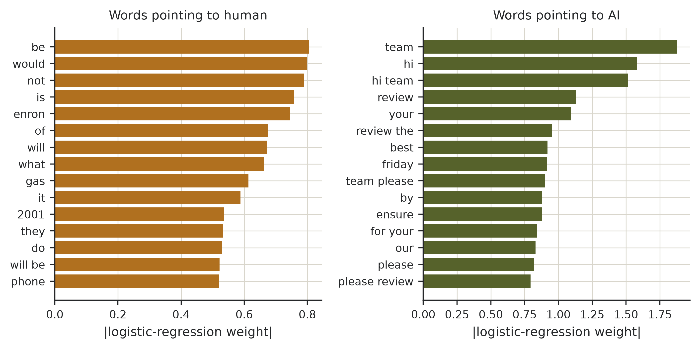

<div align="center">

#  Detecting AI-Written Outreach Messages
### Robustness of text detectors across generators, perturbations and domains


**Members:** Munaza Tariq (23i-2545, group leader) · Aleesha Javed (23i-5055)
**Paper:** TITLE
**Base paper:** Shaikat et al. (2026), *Telematics and Informatics Reports* 23, 100350, doi:10.1016/j.teler.2026.100350 (quartile proof in `paper/`)

</div>

---

##  At a glance

| | |
|---|---|
| **Question** | Do AI-text detectors keep working on workplace-style messages when the generator, the formatting or the domain changes? |
| **Own corpus** | 296 human emails (AESLC / Enron subset) + 296 AI emails written for the *same subjects* by two LLMs (`gpt-oss-120b`, `qwen3-27b`) |
| **Second dataset** | HC3 (human vs ChatGPT answers), 300 + 300 texts |
| **Models** | Base: TF-IDF + logistic regression · Extended: + stylometric + emotion-lexicon features |
| **Statistics** | Bootstrap CIs (5,000), McNemar's test, 5 grouped random splits (topic never in both train and test) |

---

##  Quick start

```bash
# 1. environment
python -m venv .venv
source .venv/bin/activate          # Windows PowerShell: .venv\Scripts\activate
pip install -r requirements.txt

# 2. data -> data/raw/own_corpus.csv and data/raw/external_corpus.csv
#    (columns: text_id,text,label,generator,domain; see data/codebook.csv)
#    data/raw/ is not in the repo. On a fresh clone rebuild it from data/clean/:
python src/00_rebuild_raw_from_clean.py

# 3. emotion lexicon (once; needs nrclex) -> data/raw/emotion_lexicon.csv
python src/10_make_emotion_lexicon.py

# 4. analysis (run from the project folder, in this order), or simply: ./run_all.sh  /  .
un_all.ps1
python src/01_clean_data.py
python src/02_base_model.py
python src/03_extended_model.py
python src/04_robustness.py
python src/08_top_features.py
python src/09_repeated_splits.py
python src/11_artefact_checks.py
python src/12_calibration_and_cleaning.py
python src/05_plots.py
```

>  Smoke test without real data: `python src/make_demo_data.py` writes **synthetic** toy data. Never report demo output.
> The notebook `notebooks/i235055.ipynb` runs the same steps in the same order.

<details>
<summary><b> Rebuilding the datasets from scratch</b></summary>

```bash
# human emails (Yale-LILY/aeslc on Hugging Face) -> data/raw/human_sampled.csv
python src/06_build_corpus.py prepare --n 300

# AI emails for the same subjects (API key in env var LLM_API_KEY, never in code)
python src/06_build_corpus.py generate --provider groq --model MODEL --name NAME --start 0 --end 150

# merge into data/raw/own_corpus.csv
python src/06_build_corpus.py assemble

# external corpus (HC3) and emotion lexicon (NRC EmoLex via the nrclex package)
python src/07_build_external.py --per-class 150
python src/10_make_emotion_lexicon.py
```

Human text was scrubbed of e-mail addresses, phone numbers, URLs and a few personal details; names were not removed automatically.
</details>

---

##  Project structure

```
mg3010-ai-text-detection/
├── config.py                  seed, paths, figure style
├── requirements.txt
├── data/
│   ├── raw/                   own_corpus.csv, external_corpus.csv, emotion_lexicon.csv
│   ├── clean/                 cleaned + split data
│   └── codebook.csv
├── src/
│   ├── 00_rebuild_raw_from_clean.py  fresh clone: rebuild data/raw from data/clean
│   ├── 01_clean_data.py       cleaning + train/val/test split (grouped by subject)
│   ├── 02_base_model.py       base model
│   ├── 03_extended_model.py   extended model, bootstrap CIs, McNemar
│   ├── 04_robustness.py       perturbations, unseen generators
│   ├── 05_plots.py            figures (400 dpi)
│   ├── 06-07, 10_*.py         dataset and lexicon builders
│   ├── 08_top_features.py     explainability / artefact check
│   ├── 09_repeated_splits.py  grouped splits, ablation, cross-corpus transfer
│   ├── 11_artefact_checks.py  shortcut / artefact checks
│   └── 12_calibration_and_cleaning.py  exploratory: calibrated threshold + cleaned corpus
├── notebooks/                 i235055.ipynb
├── tables/                    CSV results
├── figures/                   PNG + PDF
├── diagram_sources/           editable .drawio files
└── paper/                     main.tex, references.bib
```

---

##  Results

> Filled from the final run on real data. Update this table if you rerun anything.

**Fixed grouped split (test n = 120; HC3 zero-shot n = 600)**

| Model | Own F1 [95% CI] | Own AUC | HC3 F1 | HC3 AUC |
|---|---|---|---|---|
| Base (TF-IDF) | 0.992 [0.972, 1.000] | 1.000 | 0.000 | 0.451 |
| Extended | 0.911 [0.850, 0.959] | 0.973 | 0.018 | 0.299 |

**F1 over 5 grouped random splits (mean ± SD)**

| Model | Own emails | HC3 |
|---|---|---|
| Base (TF-IDF) | 0.989 ± 0.006 | 0.945 ± 0.015 |
| + stylometric | 0.927 ± 0.019 | 0.941 ± 0.008 |
| + stylometric + emotion | 0.932 ± 0.023 | 0.926 ± 0.021 |

**Robustness, fixed split (F1, base / extended)**

| Test | Base | Extended |
|---|---|---|
| none | 0.992 | 0.911 |
| typos | 0.975 | 0.868 |
| no punct lower | 0.992 | 0.506 |
| shuffle sentences | 0.992 | 0.918 |
| strip boilerplate | 0.947 | 0.908 |
| gpt oss 120b (unseen) | 0.800 | 0.862 |
| qwen3 27b (unseen) | 0.824 | 0.852 |

**Cross-corpus transfer (ROC-AUC, base):** own → HC3 0.460, HC3 → own 0.658; no model is clearly above chance in both directions (see `tables/transfer.csv`).

**Exploratory (step 12): validation-calibrated threshold and artefact-cleaned corpus.** F1 on unseen generators, 5 grouped splits × 2 held-out generators (mean ± SD):

| Model | Corpus | Threshold 0.5 | Validation-calibrated |
|---|---|---|---|
| Base | original | 0.784 ± 0.075 | 0.957 ± 0.036 |
| Base | cleaned | 0.734 ± 0.075 | 0.927 ± 0.032 |
| Extended | original | 0.865 ± 0.032 | 0.846 ± 0.047 |
| Extended | cleaned | 0.869 ± 0.030 | 0.818 ± 0.057 |

Full tables, LaTeX versions and the H6 decision: `paper/RESULTS_UPDATE.md` (regenerate with `python paper/make_results_update.py`).

###  Figures

Figures 4-9 are produced by `src/05_plots.py` (400 dpi PNG + vector PDF in `figures/`). Figures 1-3 are drawn by hand (draw.io) and kept as editable sources in `diagram_sources/`. To fill a placeholder, save the image under the given name and uncomment its line.

#### Figure 1. Research design / methodology flowchart
<!--  -->
> *Placeholder: `figures/research_design.png`. Caption: end-to-end pipeline from data collection (AESLC emails, LLM generation, HC3) through cleaning, base and extended models, robustness tests and evaluation.*

#### Figure 2. Conceptual framework
<!--  -->
> *Placeholder: `figures/conceptual_framework.png`. Caption: how generator, formatting and domain shifts are expected to affect detector performance, and where stylometric and emotion features enter.*

#### Figure 3. Case-study diagram
<!--  -->
> *Placeholder: `figures/case_study.png`. Caption: practical use case, screening incoming outreach messages with a detector and what happens when the sender changes LLM or formatting.*

#### Figure 4. ROC curves, own emails vs HC3


*Base vs extended model on the held-out own test set (left) and zero-shot on HC3 (right).*

<table>
<tr>
<td align="center" valign="top" width="50%">
<b>Figure 5. F1 over 5 grouped splits</b><br>
<br>
<i>Mean ± SD, each split a dot, for base, + stylometric and + stylometric + emotion models.</i>
</td>
<td align="center" valign="top" width="50%">
<b>Figure 6. Robustness checks</b><br>
<br>
<i>F1 under typos, punctuation/case removal, sentence shuffling, boilerplate stripping and unseen generators.</i>
</td>
</tr>
<tr>
<td align="center" valign="top">
<b>Figure 7. Cross-corpus transfer</b><br>
<br>
<i>ROC-AUC when training on own emails and testing on HC3, and vice versa; dotted line is chance.</i>
</td>
<td align="center" valign="top">
<b>Figure 9. Threshold calibration (exploratory)</b><br>
<br>
<i>Unseen-generator F1 at threshold 0.5 vs a threshold chosen on the validation set (mean ± SD, 10 runs).</i>
</td>
</tr>
</table>

#### Figure 8. Words the base detector relies on


*Highest-weight words pointing to human (left) and AI (right) text. Data: `tables/top_features.csv`.*

---

##  Honest limitations

- High scores on the own corpus are partly **corpus artefacts** (`08_top_features.py`: *hi team*, *friday* for AI; *enron*, *2001* for human; `11_artefact_checks.py`: greetings, [Your Name] placeholders and typographic characters appear almost only in AI emails).
- The fixed split is grouped by subject: a human email and the AI email written for the same subject are always in the same split.
- The threshold-calibration and artefact-cleaning analysis (step 12) was added after the main analysis and is exploratory.
- The two generators are different families, but each contributes only ~150 emails.
- Grouped splits overlap, so the SDs understate the true uncertainty.
- Detectors do not transfer across domains (email ↔ HC3 Q&A); the HC3 length difference cannot be cleaned.
- Emotion features come from the NRC EmoLex word list and add no detectable value here.
- Models with stylometric features differ in the 3rd decimal across library versions; exact versions of the reported run are in `requirements_frozen.txt`.

---

##  Data and licences

- **AESLC** (Annotated Enron Subject Line Corpus), Yale-LILY on Hugging Face.
- **HC3**: Guo et al. (2023), CC-BY-SA-4.0 per its Hugging Face page.
- **NRC EmoLex**: Mohammad & Turney (2013); free for research use. Do **not** redistribute `emotion_lexicon.csv`.
- AI text generated by us; no human participants, so no consent form was required.

---

##  Contributions 

- Munaza Tariq (23i-2545): TO FILL
- Aleesha Javed (23i-5055): TO FILL

*AI-tool use is declared in the Acknowledgment of the paper.*
